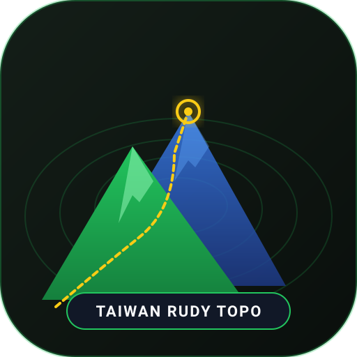

# 台灣離線魯地圖軟體 (Taiwan Rudy TOPO Offline PWA)

專為台灣登山者、山友與戶外探索者打造的現代化全台灣離線魯地圖（Taiwan Rudy TOPO）向量地圖與軌跡記錄軟體。支援在無網路（Airplane Mode / 深山環境）下零延遲瀏覽向量等高線地圖、疊加 GPX 航跡航點，並記錄個人登山軌跡。



---

## 🌟 核心特色

### 1. 100% 離線向量渲染 (Offline Vector Map)
- 基於 **MapLibre GL** 向量引擎與 **PMTiles** 單檔切片金字塔技術。
- 直接讀取全台魯地圖（`.pmtiles`）離線圖資，支援數十萬條高精度等高線（計曲線/首曲線標註）、登山路徑（主步道/難行山徑/林道分級）、百岳小百岳三角點、活水源與避難山屋。
- 採用瀏覽器現代 **OPFS (Origin Private File System)**，可無上限快取數 GB 離線大檔，告別傳統快取空間不足的問題。

### 2. GPX / KML 登山軌跡與航點套疊
- 支援選取或直接拖放（Drag & Drop）多個 `.gpx` 或 `.kml` 檔案。
- 自動解析航跡高程剖面、總距離、累計爬升/下降高度、最高/最低海拔。
- 支援點擊航點（Waypoints）查看詳細備註與坐標，一鍵聚焦視野（Fit Bounds）。

### 3. 即時 GPS 登山定位與軌跡記錄
- 支援高精度戶外 GPS 追蹤與航向方位。
- 底部登山 HUD 儀表板：即時顯示行走時間、里程、累計爬升、目前海拔高度、即時時速。
- 支援一鍵將行走軌跡匯出為標準 `GPX 1.1` 格式。
- 內建 **Screen Wake Lock API**，在戶外行進時可自動保持螢幕常亮，防止休眠中斷記錄。

### 4. 台灣專屬 TWD97 坐標雙模切換
- 頂部狀態列即時顯示 **WGS84 經緯度** 與台灣搜救、林務局及紙本地圖最通用的 **TWD97 二度分帶坐標**，發生突發狀況時便於精準報案通報。

### 5. PWA (Progressive Web App) 離線安裝
- 免下載安裝檔，打開瀏覽器即可一鍵「安裝至主畫面」，在完全無行動網路與 Wi-Fi 的環境下依然秒開運作。

---

## 🚀 快速開始

### 方式一：直接以瀏覽器開啟
1. 進入目錄 `C:\Users\ken03\.gemini\antigravity\scratch\taiwan-rudy-topo-pwa`。
2. 直接點擊 `index.html` 以現代瀏覽器（Chrome、Edge、Safari、Firefox）開啟。

### 方式二：啟動本機靜態伺服器 (推薦取得最佳 Service Worker 與 PWA 體驗)
若您有安裝任何靜態伺服器工具（如 Python、Node `http-server`、VS Code Live Server、或 Caddy 等）：
```bash
# 若有 Python 3
python -m http.server 8080

# 或若有 npx / node
npx serve .
```
在瀏覽器開啟 `http://localhost:8080` 即可享有完整的 Service Worker 離線快取功能。

### 方式三：免費部署至 GitHub Pages / Cloudflare Pages / Vercel
將此資料夾推送到 GitHub 倉庫後，開啟 GitHub Pages，即可擁有您自己的線上專屬魯地圖登山 PWA！

---

## 🗺️ 魯地圖 (Taiwan TOPO) 離線圖資獲取指南

1. **取得 PMTiles 格式圖資**：
   - 魯地圖社群（如 [Happyman 魯地圖](https://rudy.tw) 或社群開放專案）有提供台灣等高線與向量圖磚切片。
   - 亦可直接將魯地圖的 MBTiles 透過開源工具轉換為單一檔案 `.pmtiles`：
     ```bash
     pmtiles convert taiwan_rudy_topo.mbtiles taiwan_rudy_topo.pmtiles
     ```
2. **匯入本軟體**：
   - 開啟軟體，點選右側懸浮工具列的「🗺️ 圖資管理」圖示。
   - 點選「**選取本機 PMTiles 圖資**」或直接將 `.pmtiles` 拖進軟體視窗，系統將自動永久儲存至本機離線空間！

---

## 📱 手機離線安裝 (PWA 安裝教學)

- **iPhone / iPad (iOS Safari)**：
  1. 使用 Safari 開啟軟體網址。
  2. 點擊瀏覽器下方工具列的「分享」圖示（帶箭頭的方框）。
  3. 滑動並選擇「**加入主畫面 (Add to Home Screen)**」。
- **Android (Chrome / Edge)**：
  1. 使用 Chrome 開啟軟體網址。
  2. 點擊右上角「⋮」選單。
  3. 選擇「**安裝應用程式**」或「**加到主螢幕**」。

安裝完成後，手機桌面將出現「魯地圖離線」圖示，無網路登山時點開即可直接使用！

---

## 📂 專案檔案結構

```
taiwan-rudy-topo-pwa/
├── index.html                   # 應用程式主介面 (響應式深色戶外 HUD)
├── manifest.webmanifest         # PWA 安裝資訊設定
├── sw.js                        # Service Worker 離線快取守護程序
├── icons/
│   └── icon.svg                 # 專屬高解析台灣山岳向量圖標
├── css/
│   └── style.css                # 登山高對比深色主題樣式表
├── js/
│   ├── app.js                   # 應用程式主邏輯與 UI 互動控制器
│   ├── map.js                   # MapLibre GL 與 PMTiles 向量核心控制器
│   ├── topo-style.js            # 魯地圖風格渲染層 (等高線/步道/山峰/山屋)
│   ├── storage-manager.js       # OPFS (Origin Private File System) 圖資下載與離線儲存
│   ├── gpx-manager.js           # GPX/KML 解析、高程剖面、航點標記
│   └── gps-tracker.js           # GPS 定位、航跡記錄、防休眠與 GPX 導出
├── sample_tracks/
│   └── hehuan_main_peak.gpx     # 附贈合歡山主峰示範 GPX 軌跡與航點
└── README.md                    # 本說明文件
```

---

## ⛰️ 登山安全提醒

- 離線地圖與 GPS 軌跡為戶外導航輔助工具。在進入偏遠山區前，請務必充飽手機電量、攜帶行動電源，並下載備妥離線圖資與 GPX 軌跡。
- 頂部狀態列提供 **TWD97 座標**，如遇緊急搜救通報時，報出 TWD97 坐標數值可大幅提升搜救隊定位效率。
